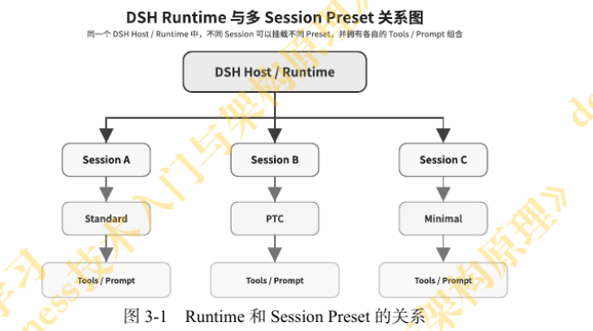
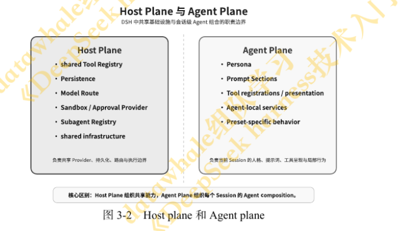
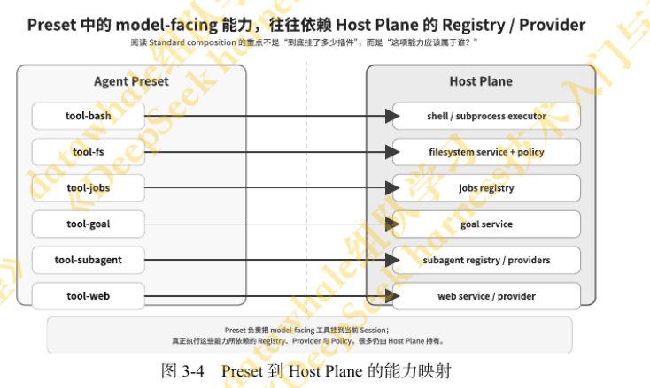

# DSH · Task3 骨架笔记（第 3 章："一切皆插件"意味着什么？）

> **承接 Task2**：Task2 亲眼看到 4 套 Preset 能力不同、轨迹不同。本章回答：它们为什么**不是 4 个独立的 Agent**？

> **核心一句话**：4 套 Preset 不是 4 个 Agent，而是同一个 Host 上挂载的不同 Agent 组合——共享的进 Host Plane，会话的进 Agent Scope，Preset 只是一张**配置单**。

## 学习目标（对应本章 5 条）

| #   | 目标                                                                   | 在本文哪里      |
| --- | ---------------------------------------------------------------------- | --------------- |
| 1   | 说清 4 套 Preset 不是 4 个独立 Agent，而是同一 Runtime 的 4 种能力组合 | 第二节          |
| 2   | 准确区分 4 个核心概念：Preset / Scope / Host Plane / Agent Plane       | 第一节          |
| 3   | 解释 Scope Context：会话级能力从哪来、为什么动态组合必须有边界         | 第四、五节      |
| 4   | 分析 Standard 能力基线：每项属于哪个作用域、由谁提供、向谁开放         | 第六节 + 分层图 |
| 5   | 对比 PTC（同能力不同呈现）与 Minimal（把 Harness 压薄）                | 第七、八节      |

## 学习策略（怎么读这一章）

1. **对照 Task2 跑过的 4 个 Session 读**：核心问题不是"Preset 长什么样"，而是"为什么不是每个 Session 复制一套完整插件树"。
2. **拿 Standard 组合树逐项标注**：每一项问两个问题——属于哪个作用域？谁提供？
3. **盯住两个"反直觉点"**：PTC 只加 Tool Presentation 却改变了使用方式；Minimal 为什么适合当 Benchmark。
4. **回看 Task2 实验记录印证 + 画图**：纯概念章，只有画图才落得住。

## 一、四个概念（先立骨架）

| 概念            | 一句话                                                                                                                                                                                           | 归属 / 边界          |
| --------------- | ------------------------------------------------------------------------------------------------------------------------------------------------------------------------------------------------ | -------------------- |
| Host Plane      | 全进程共享的地基：Tool Registry、Persistence、Model Route、Sandbox / Approval、Subagent Registry、shared infrastructure 工具注册表、持久化、模型路由、沙盒/审批、子代理注册表、共享基础设施 | 共享、常驻           |
| Agent Plane     | 当前会话自己的组合：Persona、Prompt Sections、Tool registrations / presentation、Agent-local services、Preset-specific behavior 角色、提示部分、工具注册/展示、代理本地服务、预设特定行为   | 跟随 Agent / Preset  |
| Scope（作用域） | 一项能力"**属于谁、谁能看见、跟谁一起销毁**"                                                                                                                                                     | 边界                 |
| Preset          | 一张配置单：只决定当前会话挂载哪些 Agent 级能力                                                                                                                                                  | 不是 Agent、不是拷贝 |

## 二、4 套 Preset ≠ 4 个 Agent（3.1）

- 常见误解：4 个 Agent / 4 套代码 / 4 个不同 Loop。
- 实际（根据`agent.cordis.yml`的设计）：Host 保留**一套共享常驻组合**（模型、注册机制、持久化等基础设施）→ 某 Session 进入自己的 Agent 作用域 → 挂载对应 Preset 提供的 Tool / Prompt / 会话级能力。
- 图 3-1：一个 Runtime，多个 Session 各自挂不同 Preset，能力组合互不影响。

- 结论：Preset 定义的是"**当前会话需要挂载哪些 Agent 级能力**"，不是一套独立 Agent。

> 一句话记忆：一个进程，一套地基；三间房，三种装修。Preset 是装修单。

## 三、Host Plane vs Agent Plane（3.2）

> 图 3-2 的分层不是作者自创，来自 **Creative Preset 的源码注释**——官方自己就这么划分。

|            | Host Plane                                                                     | Agent Plane                                                    |
| ---------- | ------------------------------------------------------------------------------ | -------------------------------------------------------------- |
| 回答的问题 | 系统**如何提供、统一管理**能力                                                 | 当前会话**如何选择、组合、呈现**能力                           |
| 典型内容   | Tool Registry、Persistence、Model Route、Sandbox / Approval、Subagent Registry | Persona、Prompt Sections、Tool 注册与呈现、Agent-local service |
| 比喻       | 大楼的水电、门禁、财务、IT                                                     | 每家公司自己的岗位与流程                                       |

- **是分工原则，不是绝对物理边界**（关键，别去找"这个工具属于哪个文件夹"）。
- 同一个 Tool 拆开看：实现 / 注册 / 执行设施在 **Host**；是否可见、叫什么名、参数格式、Native 还是 Code Mode 在 **Agent**。

> 一句话记忆：Host 管"怎么有"，Agent 管"怎么用"。

## 四、两种极端与中间路线（3.2.1）

| 方案                            | 问题 / 代价                                                                     |
| ------------------------------- | ------------------------------------------------------------------------------- |
| 全部放全局                      | Session A 新增的 Tool / 角色 / 服务会影响 Session B，会话互相干扰，甚至同名冲突 |
| 每个 Agent 单独起一整套基础设施 | 模型路由、持久化、沙箱、子 Agent 注册中心重复创建；成本高、难统一管理           |
| **DSH 中间路线**                | Host 持 process-singleton 能力，各 Agent Scope 挂不同 Preset                    |

- Preset 提供的能力只在当前 Agent 的 **Scope Context**（作用域上下文）中生效；Host 的共享设施可被多 Session 共用。
- 一项能力最终能被哪些 Session 看见，取决于**注册在哪个作用域**，不能只看文件 / 目录位置。

## 五、作用域三问（3.2.2）

动态组合必须同时回答三个问题：

1. 这项能力**属于谁**？
2. **谁可以看到和使用**它？
3. 它应该**跟随谁的生命周期**一起创建和销毁？

- 注册错位置的后果：只该属于当前会话的服务若注册到全局 → 变成所有 Session 可访问，甚至与其他会话的同名服务冲突。

## 六、Standard = 能力基线（3.3）

- 组合项：Persona / Instructions、Filesystem、Shell、Search / Web、Skills、Plan / Goal、Context / Compaction、Subagent、Workflow、Interaction。（人物角色、提示部分、工具注册/演示、代理本地服务、预设特定行为）
- 看点不是"有多少插件"，而是：每项能力**属于哪个作用域、由谁提供、最终向谁开放**。
- 图 3-4：Preset 的 model-facing 工具，背后都依赖 Host 的 Registry / Provider：

| Preset 侧（模型可见） | Host 侧（真正执行）           |
| --------------------- | ----------------------------- |
| tool-bash             | shell / subprocess executor   |
| tool-fs               | filesystem service + policy   |
| tool-jobs             | jobs registry                 |
| tool-goal             | goal service                  |
| tool-subagent         | subagent registry / providers |
| tool-web              | web service / provider        |

- 表 3-1 四类组合项：

| 类别            | 负责什么                            | 典型内容                                                | 生命周期              |
| --------------- | ----------------------------------- | ------------------------------------------------------- | --------------------- |
| 角色与提示词    | 定义 Agent 身份、行为方式、提示内容 | Persona、Prompt Section、Skill Catalog                  | 跟随 Agent / Preset   |
| 面向模型的工具  | 决定当前 Agent 暴露哪些 Tool        | FS / Shell / Web / Goal / Subagent 等 Tool contribution | 跟随 Agent / Preset   |
| 会话级状态      | 保存当前 Agent / Session 运行状态   | Plan / Goal / Workflow 的会话级部分                     | 跟随 Agent / Session  |
| Host 能力适配项 | 把 Host 已有能力接入当前 Agent      | Tool Registry、Model Route、Sandbox、Subagent Registry  | Host 提供、Agent 消费 |

> 注：任务说明把组合项归纳为**三类**（面向模型的工具 / 会话级状态 / Host 能力适配项），把"角色与提示词"并入面向模型的能力；本书原表为四类，此处以书为准。

- **设计自定义 Preset 的实用思路：先判断要改哪一层，再决定改什么。**
  - "当前会话不允许用写文件工具" → Agent Plane 调工具集 / 使用限制
  - "所有文件操作必须在远程容器执行" → 换 Host Plane 的 FS / Sandbox Provider

- **为什么很多自定义 Agent 越做越复杂**：一开始没把两类问题分开——
  1. "模型能看到和使用什么能力"（Agent Plane 的事）
  2. "这些能力在底层由谁、在哪里执行"（Host Plane 的事）
     混在一起，就会在错误的层上改东西，越改越乱。

## 七、PTC = 同一批能力，不同呈现（3.4）

- 目录名 `code/`，产品界面显示 PTC；**不是重写 Agent**，而是 Standard + Code Mode SDK + 改 Tool Presentation（`mode: code`）。
- DSH 把两个问题分开：**系统里有哪些工具**（Tool Registry，在 Host，不变）与**工具以什么方式提供给模型**（Presentation，在 Agent，可切）。

|          | Native Tool Calling                        | PTC（Code Presentation）                                    |
| -------- | ------------------------------------------ | ----------------------------------------------------------- |
| 模型看到 | JSON Tool Schemas JSON工具模式             | Typed TypeScript SDK                                        |
| 流程     | LLM → Tool A → LLM → Tool B → LLM → Tool C | LLM → 生成 TS 程序（循环/条件/并行）→ run_code → 结果 → LLM |
| 特点     | 每步都回 LLM 决策                          | 部分确定性流程交给代码，减少 round trip                     |

- 关键：**能力拥有**与**使用方式**解绑。
- 取舍：减少 round trip （模型与工具之间的往返调用）是设计目标，**不是无条件的性能保证**——取决于任务是否适合程序化编排、模型生成代码质量、工具返回数据量。（Task2 里 PTC 4 轮 12+ 次调用就是反例。）
- **同一进程的多个 Session，可以共享同一个 Tool Registry，却各自采用不同的工具呈现方式**（Native / Code）——这是分层最直接的体现。
- Cordis 依赖机制：`codeRuntimeService` 不存在时，依赖它的组件停在 **PENDING**，等所需服务出现，而不是等模型真调 run_code 才报错。
- 注：DSH 更新很快，具体依赖、缺依赖时进入什么状态，应以当前版本实际声明的依赖关系为准（呼应 Task1：骨架放心依赖，细节别当契约）。
- 纠正误解：不是"Standard 多了个 run_code 工具"，而是"**改变了当前 Agent 使用工具的方式**"。

> 一句话记忆：不换工具，只换用法。

## 八、Minimal = 把 Harness 压到非常薄（3.5）

- 不是"弱版 Standard"，而是**尽量减少模型能直接看到和使用的 Harness 能力**。
- 当前组合：`includeRuntimeContext: false`、不启用上下文压缩；按任务说明，其特征是**固定 Prompt + 持久 Bash + str_replace_editor**。减少的不只是工具数量，还有提示词来源、运行时上下文，降低模型面对的决策复杂度。
- 定位：**"Model + 极简 Harness"的观察基线** → 接上 Task2 "Benchmark 为什么选 Minimal"。
- 但模型看不见 ≠ Host 不管：终端会话仍依赖 Host 的沙箱策略与命令执行环境。
- 一句话：模型看到的能力可以很少，**底层执行边界和安全治理仍然存在**。

## 官方自测 3 问

**Q1：DSH 的分层避免了哪两种极端？各自代价是什么？**

- 极端一：全部放全局 → 会话互相干扰（A 加 Tool 影响 B），还有同名冲突风险；代价是污染与耦合。
- 极端二：每个 Agent 独立起一整套基础设施 → 重复创建模型路由、持久化、沙箱、子 Agent 注册中心；代价是成本高、难统一管理。
- DSH 走中间：Host 持单例，Agent Scope 挂 Preset contribution。

**Q2："会话 A 新增的 Tool 影响到会话 B"——问题出在哪一层？**

- 出在 **Scope（作用域）**：这个 Tool 本该注册在 A 的 Agent Scope 内，却被注册到了全局 / 共享范围，导致越界可见。修法是让它在 Agent Plane 里注册到自己的作用域，跟随 A 的生命周期创建和销毁。

**Q3：PTC 与 Standard 在源码层面的差异有多小？改变的是什么？**

- 差异极小：`code/agent.cordis.yml` 基本保留 Standard 原有运行时组合，只额外加入 Tool Presentation（`mode: code`）与 Code Mode SDK。
- 改变的是**模型看到和使用工具的方式**（呈现方式）；Tool Registry 仍在 Host Plane，能力本身没有重写。

## 参考作业

### ① Host Plane / Agent Plane 分层图（Standard 10 项组合项 → 12 个标注条目）

→ 见 [homework.html](./homework.html)：左侧 Agent Plane 按 4 类标 12 项（角色与提示词 3 / 工具 5 / 会话状态 3 / 交互 1），右侧 Host Plane 标 9 项（共享设施 4 + 执行方 5），中间 5 条**水平**箭头是"必须跨层的 Tool → 服务"映射。每个英文术语都带中文翻译，图内附"为什么只有 5 条箭头"的说明。

### ② 改 Agent Plane vs 改 Host Plane（自己的例子）

| 需求                                                                      | 改哪一层        | 具体动什么                                         |
| ------------------------------------------------------------------------- | --------------- | -------------------------------------------------- |
| 这个 Session 做笔记实验时**禁用 web_search**，别让模型跑去联网            | **Agent Plane** | 调整当前会话可见的工具集 / 使用限制，不碰底层      |
| **所有文件操作必须落在 WSL 的 dsh-lab 目录内**，绝不能碰 Windows 文档目录 | **Host Plane**  | 换 / 配置文件系统与沙箱的 Provider，改的是执行边界 |

判断口诀：**"这个会话能不能看见 / 怎么用" → Agent Plane；"所有会话都必须这样执行" → Host Plane。**

## 速记

1. 4 套 Preset ≠ 4 个 Agent：一个 Host + 各自的 Agent Scope
2. Host Plane 管"怎么提供和管理"，Agent Plane 管"怎么组合和呈现"——分工原则，不是物理边界
3. 作用域三问：属于谁 / 谁能看见 / 跟谁一起销毁
4. 能力拥有 ≠ 使用方式：PTC 换呈现，不换工具
5. PTC 减少 round trip 是目标，不是性能保证
6. Minimal 是观察基线：模型看见的少，底层治理还在
7. 一切皆插件 = 每项能力有明确作用域，不是"东西随便换"

## 我的理解检验（自答记录）

> 问：Standard 的 Session 里临时加一个 Skill，会不会在 PTC 的 Session 里出现？
> 答：不会，作用域不一致；这属于 Agent Plane 的事。✅
> 补：Skill 本身注册在 Agent Scope，但它依赖的文件系统 / Shell 仍在 Host Plane——**"谁提供"和"谁组合"分属两层**。

## 待确认

- 本章无动手实验（纯概念章）。
- 分层图为个人绘制，用于作业①；坐标/命名以本书图 3-2、3-4 为准。

## 下一步（Task4 预告）

- **Cordis** 是下一站：Context / Service / Event / Effect / Lifecycle——本章只露了"依赖缺失就 PENDING"一角。
- 悬念：插件之间怎么声明依赖？生命周期由谁管？→ 对应学习路径第 5 步「理解 Cordis」。
